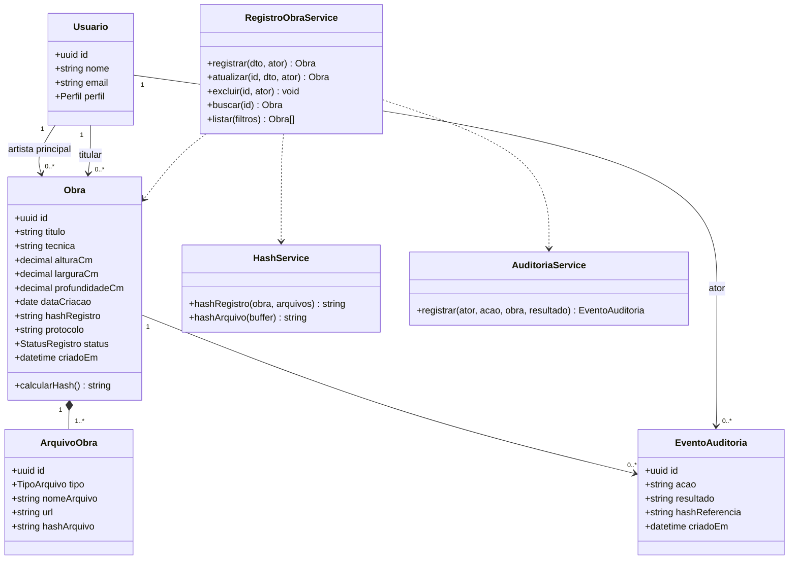

# Autentificador de Galeria de Arte — UC-03 Registrar Obra

> Esta entrega (nos diretórios backend, frontend e database) implementa **um caso de uso completo**: **UC-03 — Registrar obra** (RF-002), com interface web, API REST e banco de dados SQL.

## Sumário

1. [Sobre o projeto](#1-sobre-o-projeto)
2. [Escopo da implementação](#2-escopo-da-implementação)
3. [Rastreabilidade (UC, RF, RN, RNF)](#3-rastreabilidade)
4. [Tecnologias](#4-tecnologias)
5. [Arquitetura e estrutura de pastas](#5-arquitetura-e-estrutura-de-pastas)
6. [Modelo de dados e diagrama de classes](#6-modelo-de-dados-e-diagrama-de-classes)
7. [API REST](#7-api-rest)
8. [Como executar](#8-como-executar)
9. [Fluxo de trabalho (Jira + GitHub)](#9-fluxo-de-trabalho-jira--github)
10. [Equipe](#10-equipe)
11. [Status e próximos passos](#11-status-e-próximos-passos)

---

## 1. Sobre o projeto

O **Autentificador de Galeria de Arte** é uma plataforma para registrar obras de arte, certificá-las e acompanhar sua proveniência e titularidade de forma rastreável e verificável por hash.

Nesta etapa final, implementamos o **UC-03 — Registrar obra**: um Artista ou uma Galeria cadastra uma obra com seus dados, imagens e prova de titularidade; o sistema valida as informações, gera um **ID único**, calcula o **hash** do registro, grava os arquivos e registra o evento de auditoria.

## 2. Escopo da implementação

### Dentro do escopo

- Registrar obra (criar), listar, consultar detalhe, editar e excluir (CRUD).
- Validação de campos obrigatórios e de titularidade.
- Geração de ID único, hash SHA-256 do registro e protocolo de registro.
- Detecção de duplicidade (mesmo hash/ID bloqueado; obras semelhantes geram alerta).
- Upload de imagens e prova de titularidade, com hash por arquivo.
- Registro de evento de auditoria em tabela somente de inserção.
- Interface web (React) para todo o fluxo.

### Fora do escopo (simulado ou não implementado)

| Item | Tratamento |
|---|---|
| Login / cadastro de conta (UC-01, UC-02) | O ator é escolhido a partir de usuários de teste (seed). Não há autenticação real (conforme o professor solicitou, não fizemos implementação de tela de login). |
| Blockchain e armazenamento descentralizado | **Simulados.** O evento é gravado com status `PENDENTE`; a integração real fica como evolução. |
| Certificação, chave de autenticidade, transferência, aquisição | Outros casos de uso, não implementados. |
| Pagamentos | Fora do escopo do produto nesta versão (RN-013). |

## 3. Rastreabilidade

| Tipo | Itens |
|---|---|
| Caso de uso | UC-03 — Registrar obra |
| Requisito funcional | RF-002 |
| Regras de negócio | RN-005 (unicidade do ID e do Hash da obra), RN-008 (auditoria: mantém rastreáveis todas as operações sensíveis realizadas com as obras), RN-011 (artista principal único para cada obra e inclusão da obra no portfólio) |
| Requisitos não funcionais atendidos | RNF-001 (dados pessoais fora da camada de evidência - os dados originais dos usuários permanecem protegidos), RNF-002 (auditoria imutável - nenhum usuário pode alterar eventos de auditoria uma vez que eles são concluídos), RNF-004 (estado pendente/confirmado), RNF-009 (hash de arquivos) |

**Fluxo principal (UC-03):**

1. O ator informa dados da obra e titularidade.
2. O sistema valida os dados, identifica duplicidades e gera ID/hash.
3. O sistema armazena os arquivos autorizados e registra o evento.

**Fluxos de exceção:** cadastro incompleto, titularidade não comprovada, obra já registrada (ID/hash duplicado).

**Pós-condição:** obra cadastrada e disponível para certificação.

## 4. Tecnologias

> Ajuste esta tabela se o grupo escolher outra stack.

| Camada | Tecnologia |
|---|---|
| Frontend | React + Vite + TypeScript |
| Backend | NestJS (Node.js + TypeScript), API REST |
| Banco de dados | PostgreSQL via Supabase |
| Arquivos | Supabase Storage |
| Gestão | Jira (sprints de 7 dias) + GitHub (branches por task) |

## 5. Arquitetura e estrutura de pastas

```
Frontend (React)  ──HTTP/JSON──▶  API REST (NestJS)  ──▶  Supabase (PostgreSQL + Storage)
```

```
.
├── backend/
│   ├── src/
│   │   ├── obras/            # controller, service, dto, entity do UC-03
│   │   ├── arquivos/         # upload e hash de arquivos
│   │   ├── auditoria/        # registro de eventos
│   │   ├── common/           # hash.service, filtros de erro, validações
│   │   └── main.ts
│   ├── test/
│   └── .env.example
├── frontend/
│   ├── src/
│   │   ├── pages/            # ListaObras, RegistrarObra, DetalheObra, EditarObra
│   │   ├── components/
│   │   ├── services/         # chamadas à API
│   │   └── main.tsx
│   └── .env.example
├── database/
│   ├── schema.sql            # criação das tabelas
│   └── seed.sql              # usuários de teste
├── docs/                     # requisitos, regras, casos de uso, diagramas
└── README.md
```

## 6. Modelo de dados e diagrama de classes



**Enums:** `Perfil` = ARTISTA | GALERIA | (demais perfis existem no seed, mas não participam do UC-03); `StatusRegistro` = PENDENTE | CONFIRMADO; `TipoArquivo` = IMAGEM | PROVA_TITULARIDADE.

### Regras de implementação

- **ID:** UUID v4 gerado pelo backend.
- **Hash do registro (RN-005):** SHA-256 de um JSON canônico (chaves ordenadas) com título, artista, técnica, dimensões, data, titular e os hashes dos arquivos ordenados.
- **Protocolo:** sequencial legível, por exemplo `REG-2026-000001`.
- **Unicidade:** restrição `UNIQUE` em `hash_registro`. Duplicidade devolve `409`.
- **Alerta de semelhança:** mesmo artista + título normalizado já existente gera aviso na resposta, sem bloquear.
- **Auditoria (RN-008):** a tabela `evento_auditoria` aceita apenas `INSERT` (sem rotas de alteração ou exclusão).
- **Exclusão:** lógica (`excluido_em`), preservando o histórico.

## 7. API REST

Base URL: `http://localhost:3000`
O ator é informado pelo header `X-User-Id` (usuário do seed), pois o login está fora do escopo.

| Método | Rota | Descrição | Sucesso | Erros |
|---|---|---|---|---|
| POST | `/obras` | Registra uma obra (multipart: dados + arquivos) | 201 | 400, 403, 409, 422 |
| GET | `/obras` | Lista obras (filtros: `artistaId`, `titulo`, `status`) | 200 | — |
| GET | `/obras/:id` | Detalhe da obra, arquivos e eventos | 200 | 404 |
| PATCH | `/obras/:id` | Atualiza dados da obra | 200 | 400, 403, 404 |
| DELETE | `/obras/:id` | Exclusão lógica | 204 | 403, 404 |

### Exemplo — `POST /obras`

Campos do formulário:

```json
{
  "titulo": "Noite Estrelada em Maringá",
  "artistaId": "uuid-do-artista",
  "titularId": "uuid-do-titular",
  "tecnica": "Óleo sobre tela",
  "alturaCm": 80,
  "larguraCm": 60,
  "profundidadeCm": 2,
  "dataCriacao": "2025-03-15"
}
```

Arquivos: `imagens[]` (1 ou mais) e `provaTitularidade` (obrigatório).

Resposta `201`:

```json
{
  "id": "6f1c1c1e-...",
  "protocolo": "REG-2026-000001",
  "hashRegistro": "9b74c9897bac770ffc029102a200c5de...",
  "status": "PENDENTE",
  "alertas": []
}
```

### Códigos de erro (fluxos de exceção do UC-03)

| Situação | HTTP |
|---|---|
| Cadastro incompleto / campo inválido | 400 |
| Ator sem permissão de registro | 403 |
| Obra com hash/ID já registrado | 409 |
| Titularidade não comprovada | 422 |

## 8. Como executar

### Pré-requisitos

- Node.js 20 ou superior
- Git
- Conta e projeto no [Supabase](https://supabase.com)

### 1. Clonar

```bash
git clone [URL-DO-REPOSITORIO]
cd [NOME-DO-REPOSITORIO]
```

### 2. Banco de dados

1. Crie um projeto no Supabase.
2. No *SQL Editor*, execute `database/schema.sql` e depois `database/seed.sql`.
3. Crie um bucket de Storage chamado `obras`.

### 3. Backend

```bash
cd backend
cp .env.example .env     # preencha as variáveis abaixo
npm install
npm run start:dev
```

`backend/.env`:

```
SUPABASE_URL=
SUPABASE_SERVICE_KEY=
SUPABASE_BUCKET=obras
PORT=3000
```

### 4. Frontend

```bash
cd frontend
cp .env.example .env
npm install
npm run dev
```

`frontend/.env`:

```
VITE_API_URL=http://localhost:3000
```

Acesse `http://localhost:5173`.

### Testes

```bash
cd backend && npm run test
```

> Nunca faça commit de arquivos `.env` ou de chaves do Supabase.

## 9. Fluxo de trabalho (Jira + GitHub)

Hierarquia de trabalho: **Epic → Story → Task/Bug**.

```
main                          # versão estável
└── dev                       # Epic: UC-03 Registrar Obra
    └── gal-0NN-nome-da-story     # Story
        └── gal-0NN-nome-da-task      # Task / Bug (uma por pessoa)
```

- Cada item do Jira vira uma branch cujo nome começa pela chave do item (ex.: `gal-014-criar-endpoint-post-obras`).
- O merge sempre acontece **de baixo para cima**: task → story → dev → main, via Pull Request com revisão de pelo menos um colega.
- Commits no padrão `tipo(escopo): descrição [GAL-014]`, por exemplo `feat(obras): valida campos obrigatórios [GAL-014]`.
- Ciclos (sprints) de 7 dias; o primeiro ciclo começou em 03/11.

O detalhamento do backlog está em [`docs/PLANO_DE_TRABALHO.md`](docs/PLANO_DE_TRABALHO.md).

## 10. Equipe

| Nome | Responsabilidade principal |
|---|---|
| [Nome 1] | [ex.: Backend / banco] |
| [Nome 2] | [ex.: Frontend] |
| [Nome 3] | [ex.: Frontend / testes] |
| [Nome 4] | [ex.: Documentação / diagramas] |

Professor: [Nome]

## 11. Status e próximos passos

- [ ] Estrutura do projeto e conexão com o Supabase
- [ ] API: registrar obra (POST)
- [ ] API: listar, detalhar, editar e excluir
- [ ] Upload de arquivos com hash
- [ ] Auditoria de eventos
- [ ] Interface web completa
- [ ] Testes e revisão final

**Evoluções futuras:** integração real com blockchain e armazenamento descentralizado, autenticação (UC-01/UC-02), certificação (UC-04) e emissão de chave (UC-05).
